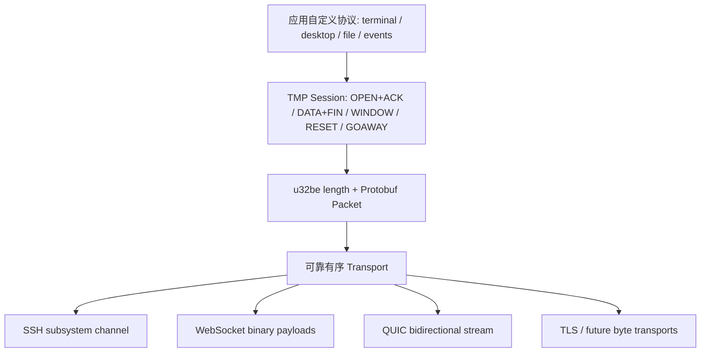

# TMP — Tunnel Mux Protocol

面向远程桌面、终端和会话事件流的传输无关多路复用协议。第一版使用 Protobuf 定义、Buf 管理 schema 与三语言代码生成，提供 Rust、Go、Node/TypeScript SDK。



新增 SSH、WS、QUIC 或其他网络适配只需满足 Transport 合同，不修改 core schema。v1 的 QUIC 绑定使用一条可靠双向 stream；原生 QUIC 多流和不可靠媒体传输不是本版能力。

## 文档与源码

- [协议规范](docs/protocol-v1.md)：wire、传输绑定、握手、流控、关闭、应用 profile。
- [Protobuf schema](proto/tmp/v1/mux.proto)：唯一语言无关定义。
- [SDK 合同](docs/sdk-contract.md) · [演进与 Buf 版本管理](docs/evolution.md)。
- [独立设计评审](docs/reviews/design-review.md) · [实现评审](docs/reviews/implementation-review.md) · [验证记录](docs/verification.md)。
- [Rust SDK](sdk/rust/README.md) · [Go SDK](sdk/go/README.md) · [Node SDK](sdk/node/README.md)。
- 旧 `TMP 协议规范 v1(Tunnel Mux Protocol).md` 仅保留历史依据，旧 wire 标识 `tunnel.tmp1` 与当前 `tmp.pb.v1` 不兼容。

## 运行 demo

[示例指南](examples/README.md)提供 Rust、Go、Node 可互通的 TCP 客户端/服务端、五流并发与文件回传，以及 WebSocket、SSH stdio 和独立 QUIC 承载示例。

```sh
python3 scripts/demo_smoke.py
```

## 安装与发布

Rust crate 为 `tunnel-mux`，Go 子模块为 `github.com/lib-x/tm/sdk/go`，Node 包为 `@lib-x/tmp`。各语言使用独立 tag 和 Release，安装命令及打包约定见 [SDK 发布说明](docs/releases.md)。

## 构建与验证

已提交生成模型，SDK 用户不需要安装 protoc 或 Buf。维护者工具版本见 `mise.toml`（Buf 1.75.0），Rust 使用 edition 2024。

```sh
mise install
scripts/generate.sh       # Buf lint + 三语言生成，需要 BSR 网络访问
buf breaking --against conformance/v1-baseline.binpb
scripts/check.sh          # 编译/单测/静态检查/跨语言互通
```

`buf.gen.yaml` 固定 remote plugin 版本和 revision。CI 检查生成文件未漂移，并对照初版 descriptor 和 PR base 检查 breaking changes；修改协议语义仍须独立评审。

## 使用边界

SDK 是无后台任务的 Sans-I/O 状态机加 framing/stream adapter；宿主负责认证连接、事件循环、超时、调度和业务授权。SSH 校验 host key、WS 使用 wss 并校验 Origin、QUIC 校验证书且禁用有副作用的0-RTT。所有 Session 调用必须串行，返回的帧按顺序写出，应用读走字节后显式 `consume`。

终端、桌面、herdr、文件传输、剪切板、截屏和中继发现只是[使用场景示例](docs/use-cases.md)，核心 schema 不包含任何这些业务消息。应用自行选择 profile 标识和流内格式。v1 不自动重放终端输入，不承诺断网透明恢复；恢复游标、去重和幂等性属于应用合同。重载时对输入和事件流施加背压；低延迟视频可用独立 TMP link。

验证包括公共 golden vectors、三语言 wire 模型互读和 6 组跨进程双向会话交换，以及 demo 的真实 loopback TCP、WebSocket、QUIC 和三语言 stdio 互通。SSH 接入尚未运行真实远端服务端测试；本地 demo 验证不代表生产承载与业务鉴权已经部署。
